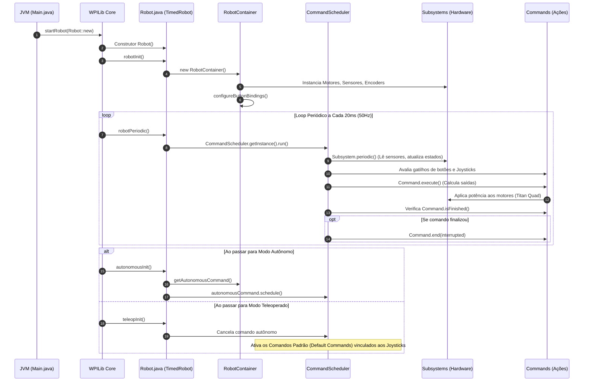

# Documentação Completa do Projeto e Guia para Robô Omnidirecional
**Competição de Robótica Móvel — WorldSkills (Skill 23)**  
*Ambiente: WPILib 2020 / Java 11 / Studica VMX-pi & Titan Quad / Kauai Labs navX*

---

## Sumário
1. [Parte 1: Análise Minuciosa dos Arquivos do Projeto](#parte-1-análise-minuciosa-dos-arquivos-do-projeto)
   - [1.1 Estrutura de Arquivos e Funções](#11-estrutura-de-arquivos-e-funções)
   - [1.2 Os Arquivos de Configuração e Build](#12-os-arquivos-de-configuração-e-build)
   - [1.3 As Dependências de Hardware (Vendordeps)](#13-as-dependências-de-hardware-vendordeps)
   - [1.4 O Código-Fonte Java (Arquitetura Command-Based)](#14-o-código-fonte-java-arquitetura-command-based)
   - [1.5 Fluxo Completo de Execução do Software](#15-fluxo-completo-de-execução-do-software)
2. [Parte 2: Passo a Passo Lógico para Robô Omnidirecional na WorldSkills](#parte-2-passo-a-passo-lógico-para-robô-omnidirecional-na-worldskills)
   - [2.1 Fundamentos da Cinemática Omnidirecional](#21-fundamentos-da-cinemática-omnidirecional)
   - [2.2 Controle Field-Oriented (Orientação de Arena) vs Robot-Oriented](#22-controle-field-oriented-orientação-de-arena-vs-robot-oriented)
   - [2.3 Passo 1: Parametrização em `Constants.java`](#23-passo-1-parametrização-em-constantsjava)
   - [2.4 Passo 2: Construção do `OmniDriveSubsystem.java`](#24-passo-2-construção-do-omnidrivesubsystemjava)
   - [2.5 Passo 3: Criação do Comando de Teleoperado (`OmniTeleopCommand.java`)](#25-passo-3-criação-do-comando-de-teleoperado-omniteleopcommandjava)
   - [2.6 Passo 4: Integração no `RobotContainer.java`](#26-passo-4-integração-no-robotcontainerjava)
   - [2.7 Passo 5: Malha Fechada de Ângulo (Heading Lock com PID e navX)](#27-passo-5-malha-fechada-de-ângulo-heading-lock-com-pid-e-navx)
   - [2.8 Passo 6: Odometria e Comandos Autônomos de Alta Precisão](#28-passo-6-odometria-e-comandos-autônomos-de-alta-precisão)
   - [2.9 Roteiro de Testes, Calibração em Bancada e Segurança](#29-roteiro-de-testes-calibração-em-bancada-e-segurança)

---

# Parte 1: Análise Minuciosa dos Arquivos do Projeto

O projeto `Passo_Passo` foi estruturado sob o paradigma **Command-Based** da biblioteca **WPILib** (versão 2020), amplamente utilizada tanto na FIRST Robotics Competition (FRC) quanto adaptada pela Studica para o ecossistema da **WorldSkills Mobile Robotics (Skill 23)** através da controladora VMX-pi (Raspberry Pi + FPGA/Coprocessador de tempo real).

Abaixo está a análise detalhada da função de cada arquivo e pasta existente no diretório:

```
Passo_Passo/
├── .wpilib/
│   └── wpilib_preferences.json
├── .vscode/
│   ├── launch.json
│   └── settings.json
├── gradle/
│   └── wrapper/
│       ├── gradle-wrapper.jar
│       └── gradle-wrapper.properties
├── src/
│   └── main/
│       ├── deploy/
│       │   └── example.txt
│       └── java/
│           └── frc/
│               └── robot/
│                   ├── commands/        (diretório de comandos)
│                   ├── subsystems/      (diretório de subsistemas)
│                   ├── Constants.java
│                   ├── Main.java
│                   ├── Robot.java
│                   └── RobotContainer.java
├── vendordeps/
│   ├── navx_frc.json
│   ├── Studica.json
│   └── WPILibNewCommands.json
├── build.gradle
├── gradlew
├── gradlew.bat
└── settings.gradle
```

---

### 1.1 Estrutura de Arquivos e Funções

#### 1. `build.gradle`
- **Função**: É o script de compilação, resolução de dependências e empacotamento do Gradle.
- **O que faz**:
  - Aplica o plugin `edu.wpi.first.GradleRIO` (versão `2020.3.2`), responsável por injetar tarefas de compilação cruzada para ARM (Linux Athena/Raspbian na VMX-pi/RoboRIO) e x86_64 para simulação desktop.
  - Define o alvo Java: compatibilidade com **Java 11**.
  - Configura o ponto de entrada da aplicação através da variável `ROBOT_MAIN_CLASS = "frc.robot.Main"`.
  - Configura a tarefa de deploy (`deploy`), que envia os binários compilados (JAR executável) e a pasta `src/main/deploy` para a VMX-pi/RoboRIO via SSH/SFTP (diretório de destino: `/home/lvuser/deploy`).
  - Adiciona as dependências do WPILib, as bibliotecas nativas (JNI/C++) e as dependências declaradas na pasta `vendordeps/`.
  - Monta o "fat JAR" unificado contendo todas as dependências necessárias para rodar no robô sem necessidade de internet em tempo de execução.

#### 2. `settings.gradle`
- **Função**: Arquivo de inicialização do Gradle que define o nome do projeto raiz (`rootProject.name = 'Passo_Passo'`).

#### 3. `gradlew` e `gradlew.bat`
- **Função**: Scripts de envelopamento do Gradle (*Gradle Wrapper*) para Linux/macOS (`gradlew`) e Windows (`gradlew.bat`).
- **O que faz**: Permite que o projeto seja compilado na versão exata do Gradle especificada em `gradle-wrapper.properties` (Gradle 6.0.1), sem exigir que o desenvolvedor tenha o Gradle instalado no sistema operacional.

#### 4. `gradle/wrapper/gradle-wrapper.properties`
- **Função**: Especifica o binário do Gradle a ser baixado e utilizado (`gradle-6.0.1-bin.zip`).

#### 5. `.wpilib/wpilib_preferences.json`
- **Função**: Metadados da extensão WPILib para o Visual Studio Code.
- **Conteúdo**:
  - `"currentLanguage": "java"`: Define a linguagem primária como Java.
  - `"projectYear": "2020"`: Ano da versão da API do WPILib.
  - `"teamNumber": 123`: Número identificador da equipe (utilizado pelo mDNS/IP estático para conexão de rede com o robô, ex: `10.1.23.2` ou `roborio-123-FRC.local` / `vmx-pi.local`).

#### 6. `.vscode/launch.json` e `.vscode/settings.json`
- **Função**: Configurações do VSCode para compilação automática em segundo plano, exclusão de pastas temporárias (`bin/`, `.classpath`) e perfil de depuração (*debugger*) conectado à JVM remota na controladora do robô.

#### 7. `src/main/deploy/example.txt`
- **Função**: Qualquer arquivo inserido em `src/main/deploy/` é automaticamente transferido durante o deploy para o robô no diretório `/home/lvuser/deploy`. Pode ser acessado programaticamente via `Filesystem.getDeployDirectory()`. Útil para arquivos de trajetórias autônomas (JSON/CSV), configurações de PID ou modelos de visão computacional.

---

### 1.3 As Dependências de Hardware (Vendordeps)

Os arquivos na pasta `vendordeps/` são manifestos JSON que informam ao GradleRIO onde baixar as bibliotecas Java e os binários nativos (DLLs no Windows, arquivos `.so` no Linux Raspbian/Athena) das placas periféricas:

#### 1. `vendordeps/Studica.json` (Versão 2.0.3)
- **Função**: Biblioteca oficial da **Studica** para o ecossistema WorldSkills / FRC.
- **Recursos fornecidos**:
  - `com.studica.frc.Titan`: Driver da controladora de motores **Titan Quad Motor Controller** (comunicação via barramento CAN), que controla até 4 motores DC de alta potência com leitura de 4 encoders de quadratura integrados.
  - Suporte a sensores Studica: sensor analógico infravermelho de distância (Sharp IR), seguidor de linha digital (Cobra), servos PWM, etc.

#### 2. `vendordeps/navx_frc.json` (Versão 3.1.413)
- **Função**: Biblioteca da **Kauai Labs** para a unidade de medição inercial (IMU) **navX-Micro / navX2-MXP**.
- **Recursos fornecidos**:
  - `com.kauailabs.navx.frc.AHRS`: Fornece dados giroscópicos de alta precisão (Yaw, Pitch, Roll), aceleração linear em 3 eixos e fusão de sensores de 9 eixos em tempo real. Essencial para controle **Field-Oriented** (orientação de arena) e travamento de ângulo (*Heading Lock*).

#### 3. `vendordeps/WPILibNewCommands.json`
- **Função**: Biblioteca da nova arquitetura de comandos do WPILib (Command-Based v2).
- **Recursos fornecidos**:
  - `edu.wpi.first.wpilibj2.command.*`: Classes fundamentais como `SubsystemBase`, `CommandBase`, `CommandScheduler`, `RunCommand`, `InstantCommand`, `SequentialCommandGroup`, `ParallelRaceGroup` e `JoystickButton`.

---

### 1.4 O Código-Fonte Java (Arquitetura Command-Based)

O código segue o padrão de arquitetura **Command-Based**, dividindo o robô em **Constantes**, **Subsistemas** (abstração de hardware) e **Comandos** (ações e comportamentos):

```
┌────────────────────────────────────────────────────────┐
│                      Robot.java                        │
│             (Ciclo de Vida e Scheduler)                │
└──────────────────────────┬─────────────────────────────┘
                           │ chama a cada 20ms
                           ▼
┌────────────────────────────────────────────────────────┐
│                   RobotContainer.java                  │
│       (Instanciação, Mapeamento de Botões e OI)        │
└──────────────┬──────────────────────────┬──────────────┘
               │                          │
               ▼                          ▼
┌──────────────────────────────┐ ┌───────────────────────┐
│       Subsystems/            │ │       Commands/       │
│  (Hardware: Titan, Encoders, │ │ (Ações: Movimentar,   │
│   Giroscópio, Garra, etc.)   │ │  Alinhar, Autônomos)  │
└──────────────────────────────┘ └───────────────────────┘
```

#### 1. `src/main/java/frc/robot/Main.java`
- **Ponto de Entrada**: Contém o método padrão `public static void main(String... args)`.
- **Papel**: Não deve conter lógica do usuário. Sua única responsabilidade é invocar `RobotBase.startRobot(Robot::new)`, que inicializa a máquina virtual WPILib e instancia a classe principal `Robot`.

#### 2. `src/main/java/frc/robot/Robot.java`
- **Classe Central do Ciclo de Vida**: Herda de `TimedRobot`.
- **Papel**: Controla a máquina de estados principal do robô em um loop de tempo rígido com período padrão de **20 ms (50 Hz)**.
- **Métodos Principais**:
  - `robotInit()`: Executado uma única vez na inicialização. Instancia o `RobotContainer`.
  - `robotPeriodic()`: Executado **a cada 20 ms ininterruptamente** (em qualquer modo: desativado, autônomo ou teleoperado). Executa `CommandScheduler.getInstance().run()`, que processa todos os subsistemas e comandos ativos.
  - `disabledInit()` e `disabledPeriodic()`: Executado quando o robô está em modo Desativado (Disabled). Corta envio de sinal aos atuadores para segurança.
  - `autonomousInit()` e `autonomousPeriodic()`: Chamado ao habilitar o modo Autônomo. Obtém o comando do `RobotContainer.getAutonomousCommand()` e o agenda.
  - `teleopInit()` e `teleopPeriodic()`: Chamado no modo Teleoperado (Pilotagem manual). Cancela comandos autônomos para permitir o controle humano pelos joysticks.
  - `testInit()` e `testPeriodic()`: Modo de diagnóstico e calibração de bancada.

#### 3. `src/main/java/frc/robot/RobotContainer.java`
- **O Maestro do Robô**: Onde o robô é estruturado declarativamente.
- **Papel**:
  - Instancia os subsistemas (motores, sensores, atuadores).
  - Instancia os controladores de entrada (ex: `XboxController` ou Joystick Logitech).
  - Configura os botões em `configureButtonBindings()`, associando eventos de clique/pressão a comandos.
  - Fornece o método `getAutonomousCommand()` que entrega a rotina autônoma escolhida para o `Robot.java`.

#### 4. `src/main/java/frc/robot/Constants.java`
- **Central de Parâmetros e Calibrações**:
- **Papel**: Classe estática para conter todos os valores numéricos do robô (IDs de CAN da Titan, portas PWM/DIO/Analógicas, canais do Joystick, resoluções de encoders, medidas geométricas do chassi, e ganhos de PID). Isso impede o uso de "números mágicos" espalhados no código.

#### 5. Pastas `commands/` e `subsystems/`
- `subsystems/`: Onde criamos as classes filhas de `SubsystemBase` que encapsulam o hardware (ex: `OmniDriveSubsystem`, `ArmSubsystem`, `GripperSubsystem`). Nenhum subsistema deve ler dados de joystick diretamente!
- `commands/`: Onde criamos classes filhas de `CommandBase` que implementam lógicas de movimentação ou controle sobre os subsistemas requeridos.

---

### 1.5 Fluxo Completo de Execução do Software

O diagrama abaixo sintetiza a ordem cronológica exata em que os métodos são invocados:



---

# Parte 2: Passo a Passo Lógico para Robô Omnidirecional na WorldSkills

A competição de **Robótica Móvel da WorldSkills (Skill 23)** exige que o robô realize tarefas em arena fechada com alta precisão e agilidade: transporte de peças, navegação entre obstáculos, alinhamento milimétrico em dispensers e estações de montagem.

Um robô **omnidirecional** possui **3 graus de liberdade no plano ($X, Y, \theta$) desacoplados**. Ele pode transladar para qualquer direção (frente, ré, lados, diagonais) enquanto gira sobre o próprio eixo simultaneamente, sem necessidade de manobras de arco como robôs diferenciais tradicionais.

---

### 2.1 Fundamentos da Cinemática Omnidirecional

A mecânica mais consagrada na WorldSkills é o uso de **rodas omnidirecionais (Omniwheels da Studica)**. Existem duas configurações principais:
1. **Kiwi Drive (3 Rodas a 120°)**: Baixo atrito, 3 motores, excelente agilidade.
2. **Holonômico 4 Rodas (90° em cruz ou 45° em X / X-Drive)**: Maior tração e estabilidade mecânica.

Abaixo demonstramos a **Cinemática Inversa** (como transformar as velocidades desejadas pelo piloto ou rotina autônoma nas rotações de cada roda).

#### O Vetor de Comando Geral:
- $V_x$: Velocidade de translação lateral (*strafe*, para direita/esquerda).
- $V_y$: Velocidade de translação longitudinal (frente/trás).
- $\omega$: Velocidade de rotação angular (giro horário/anti-horário).

#### Equações para Robô de 3 Rodas Omni a 120°:
Considerando as 3 rodas a uma distância $R$ do centro geométrico do robô com ângulos de montagem $\alpha_1 = 60^\circ$, $\alpha_2 = 180^\circ$ e $\alpha_3 = 300^\circ$:

$$\begin{cases}
V_1 = -V_x \cdot \sin(60^\circ) + V_y \cdot \cos(60^\circ) + R \cdot \omega \\
V_2 = -V_x \cdot \sin(180^\circ) + V_y \cdot \cos(180^\circ) + R \cdot \omega \\
V_3 = -V_x \cdot \sin(300^\circ) + V_y \cdot \cos(300^\circ) + R \cdot \omega
\end{cases}$$

Substituindo os valores trigonométricos:
$$\begin{cases}
V_1 = -\frac{\sqrt{3}}{2} V_x + \frac{1}{2} V_y + R \cdot \omega \\
V_2 = -V_y + R \cdot \omega \\
V_3 = \frac{\sqrt{3}}{2} V_x + \frac{1}{2} V_y + R \cdot \omega
\end{cases}$$

#### Equações para Robô de 4 Rodas Omni (X-Drive a 45°):
$$\begin{cases}
V_{\text{Frente Esquerda}} = V_y + V_x + \omega \\
V_{\text{Frente Direita}}  = V_y - V_x - \omega \\
V_{\text{Trás Esquerda}}   = V_y - V_x + \omega \\
V_{\text{Trás Direita}}    = V_y + V_x - \omega
\end{cases}$$

#### Normalização de Velocidade (Desvio Crítico!):
Se a soma dos vetores resultar em um valor maior que $1.0$ (ex: $1.2$), aplicar simplesmente `Math.min(1.0, power)` provocará distorção da trajetória planejada.  
**Solução**: Encontrar o maior valor absoluto entre as rodas e dividir todas as saídas proporcionalmente por esse máximo caso ele exceda $1.0$:

```java
double max = Math.max(Math.abs(v1), Math.max(Math.abs(v2), Math.abs(v3)));
if (max > 1.0) {
    v1 /= max;
    v2 /= max;
    v3 /= max;
}
```

---

### 2.2 Controle Field-Oriented (Orientação de Arena) vs Robot-Oriented

- **Robot-Oriented**: Empurrar o analógico para cima move o robô na direção da sua própria frente mecânica. Se o robô estiver girado a 90°, empurrar para cima faz ele andar para o lado da arena.
- **Field-Oriented (Recomendado para WorldSkills)**: Empurrar o analógico para frente move o robô em direção à extremidade superior da arena, independentemente da rotação da sua carcaça.

A conversão matemática do sistema da arena para o sistema de coordenadas local do robô utiliza o ângulo $\theta$ lido pela IMU **navX**:

$$\begin{bmatrix} V_{x, \text{robot}} \\ V_{y, \text{robot}} \end{bmatrix} = \begin{bmatrix} \cos(\theta) & \sin(\theta) \\ -\sin(\theta) & \cos(\theta) \end{bmatrix} \begin{bmatrix} V_{x, \text{field}} \\ V_{y, \text{field}} \end{bmatrix}$$

---

### 2.3 Passo 1: Parametrização em `Constants.java`

Edite `src/main/java/frc/robot/Constants.java` para consolidar o hardware:

```java
package frc.robot;

public final class Constants {
    // --- Configuração CAN da Titan Quad ---
    public static final int kTitanCanId = 42; // ID padrão da Studica Titan

    // --- Portas dos Motores na Titan ---
    public static final int kMotor1Port = 0; // Roda 1
    public static final int kMotor2Port = 1; // Roda 2
    public static final int kMotor3Port = 2; // Roda 3
    public static final int kMotor4Port = 3; // Opcional (4 rodas)

    // --- Geometria e Encoders ---
    // Encoder óptico da Studica: 1440 pulsos por revolução do eixo
    public static final double kEncoderTicksPerRev = 1440.0;
    public static final double kWheelDiameterMeters = 0.100; // Roda Omni 100mm = 0.1m
    public static final double kWheelCircumference = Math.PI * kWheelDiameterMeters;
    // Distância por tick do encoder em metros
    public static final double kMetersPerTick = kWheelCircumference / kEncoderTicksPerRev;

    // --- Controle do Piloto ---
    public static final int kDriverControllerPort = 0;
    public static final double kJoystickDeadband = 0.08; // Zona morta para ignorar ruído
    public static final double kMaxSpeedTeleop = 0.85;   // 85% de potência máxima

    // --- Ganhos do PID de Rotação (Heading Stabilization) ---
    public static final double kGyroKp = 0.035;
    public static final double kGyroKi = 0.000;
    public static final double kGyroKd = 0.002;
}
```

---

### 2.4 Passo 2: Construção do `OmniDriveSubsystem.java`

Crie o arquivo `src/main/java/frc/robot/subsystems/OmniDriveSubsystem.java`:

```java
package frc.robot.subsystems;

import edu.wpi.first.wpilibj2.command.SubsystemBase;
import edu.wpi.first.wpilibj.smartdashboard.SmartDashboard;
import edu.wpi.first.wpilibj.SPI;
import com.studica.frc.Titan;
import com.kauailabs.navx.frc.AHRS;
import frc.robot.Constants;

public class OmniDriveSubsystem extends SubsystemBase {
    // Controladora Titan e Motores
    private final Titan titan;
    private final Titan.Motor motor1;
    private final Titan.Motor motor2;
    private final Titan.Motor motor3;

    // Encoders
    private final Titan.Encoder encoder1;
    private final Titan.Encoder encoder2;
    private final Titan.Encoder encoder3;

    // Giroscópio navX
    private final AHRS navx;

    public OmniDriveSubsystem() {
        titan = new Titan(Constants.kTitanCanId);
        
        motor1 = titan.getMotor(Constants.kMotor1Port);
        motor2 = titan.getMotor(Constants.kMotor2Port);
        motor3 = titan.getMotor(Constants.kMotor3Port);

        // Inversão se necessário conforme o sentido da caixa de redução
        motor1.setInverted(false);
        motor2.setInverted(false);
        motor3.setInverted(false);

        // Inicializa Encoders com fator de conversão de distância
        encoder1 = titan.getEncoder(Constants.kMotor1Port, Constants.kMetersPerTick);
        encoder2 = titan.getEncoder(Constants.kMotor2Port, Constants.kMetersPerTick);
        encoder3 = titan.getEncoder(Constants.kMotor3Port, Constants.kMetersPerTick);

        // Inicializa IMU navX via porta SPI MXP da VMX-pi
        navx = new AHRS(SPI.Port.kMXP);
        resetGyro();
        resetEncoders();
    }

    @Override
    public void periodic() {
        // Envia telemetria contínua para o SmartDashboard
        SmartDashboard.putNumber("NavX Yaw", getHeading());
        SmartDashboard.putNumber("Enc1 Dist (m)", encoder1.getDistance());
        SmartDashboard.putNumber("Enc2 Dist (m)", encoder2.getDistance());
        SmartDashboard.putNumber("Enc3 Dist (m)", encoder3.getDistance());
    }

    /**
     * Movimentação Omnidirecional (Kiwi 3 Rodas a 120 graus)
     * @param vx Velocidade lateral (+ = Direita, - = Esquerda)
     * @param vy Velocidade linear (+ = Frente, - = Ré)
     * @param omega Velocidade angular de giro (+ = Horário, - = Anti-horário)
     * @param fieldOriented True para modo relativo à arena, False para relativo ao robô
     */
    public void drive(double vx, double vy, double omega, boolean fieldOriented) {
        double robotVx = vx;
        double robotVy = vy;

        if (fieldOriented) {
            // Converte o ângulo do giroscópio para radianos
            double headingRad = Math.toRadians(-getHeading());
            robotVx = vx * Math.cos(headingRad) - vy * Math.sin(headingRad);
            robotVy = vx * Math.sin(headingRad) + vy * Math.cos(headingRad);
        }

        // Cinemática Inversa 3 Rodas (Kiwi Drive a 120°)
        double sqrt3_2 = Math.sqrt(3.0) / 2.0;
        double v1 = -sqrt3_2 * robotVx + 0.5 * robotVy + omega;
        double v2 = -robotVy + omega;
        double v3 =  sqrt3_2 * robotVx + 0.5 * robotVy + omega;

        // Normalização das potências para manter a proporção do vetor resultante
        double max = Math.max(Math.abs(v1), Math.max(Math.abs(v2), Math.abs(v3)));
        if (max > 1.0) {
            v1 /= max;
            v2 /= max;
            v3 /= max;
        }

        // Aplica velocidade aos motores
        motor1.set(v1);
        motor2.set(v2);
        motor3.set(v3);
    }

    public void stop() {
        motor1.set(0.0);
        motor2.set(0.0);
        motor3.set(0.0);
    }

    public double getHeading() {
        return Math.IEEEremainder(navx.getAngle(), 360.0);
    }

    public void resetGyro() {
        navx.reset();
    }

    public void resetEncoders() {
        encoder1.reset();
        encoder2.reset();
        encoder3.reset();
    }
}
```

---

### 2.5 Passo 3: Criação do Comando de Teleoperado (`OmniTeleopCommand.java`)

Crie o arquivo `src/main/java/frc/robot/commands/OmniTeleopCommand.java`. Ele tratará a sensibilidade do joystick e garantirá pilotagem suave:

```java
package frc.robot.commands;

import edu.wpi.first.wpilibj2.command.CommandBase;
import edu.wpi.first.wpilibj.XboxController;
import edu.wpi.first.wpilibj.GenericHID.Hand;
import frc.robot.subsystems.OmniDriveSubsystem;
import frc.robot.Constants;

public class OmniTeleopCommand extends CommandBase {
    private final OmniDriveSubsystem driveSubsystem;
    private final XboxController controller;

    public OmniTeleopCommand(OmniDriveSubsystem driveSubsystem, XboxController controller) {
        this.driveSubsystem = driveSubsystem;
        this.controller = controller;
        addRequirements(driveSubsystem); // Bloqueia outros comandos de usarem a tração simultaneamente
    }

    @Override
    public void execute() {
        // Eixo Y no XboxController é invertido (empurrar para frente dá valor negativo)
        double vy = -applyDeadband(controller.getY(Hand.kLeft));
        double vx =  applyDeadband(controller.getX(Hand.kLeft));
        double omega = applyDeadband(controller.getX(Hand.kRight));

        // Controle quadrático para dar precisão em baixas velocidades
        vx = Math.copySign(vx * vx, vx) * Constants.kMaxSpeedTeleop;
        vy = Math.copySign(vy * vy, vy) * Constants.kMaxSpeedTeleop;
        omega = Math.copySign(omega * omega, omega) * Constants.kMaxSpeedTeleop;

        // Por padrão acionado com Field-Oriented ativado
        driveSubsystem.drive(vx, vy, omega, true);
    }

    @Override
    public void end(boolean interrupted) {
        driveSubsystem.stop();
    }

    private double applyDeadband(double value) {
        if (Math.abs(value) < Constants.kJoystickDeadband) {
            return 0.0;
        }
        return (value - Math.copySign(Constants.kJoystickDeadband, value)) / (1.0 - Constants.kJoystickDeadband);
    }
}
```

---

### 2.6 Passo 4: Integração no `RobotContainer.java`

Modifique `src/main/java/frc/robot/RobotContainer.java` para vincular o subsistema, o comando padrão e os botões:

```java
package frc.robot;

import edu.wpi.first.wpilibj.XboxController;
import edu.wpi.first.wpilibj2.command.Command;
import edu.wpi.first.wpilibj2.command.InstantCommand;
import edu.wpi.first.wpilibj2.command.button.JoystickButton;
import frc.robot.subsystems.OmniDriveSubsystem;
import frc.robot.commands.OmniTeleopCommand;

public class RobotContainer {
    // 1. Instanciação dos Subsistemas
    private final OmniDriveSubsystem driveSubsystem = new OmniDriveSubsystem();

    // 2. Instanciação do Joystick
    private final XboxController driverController = new XboxController(Constants.kDriverControllerPort);

    public RobotContainer() {
        // 3. Define o comando padrão da tração (roda continuamente durante Teleop)
        driveSubsystem.setDefaultCommand(
            new OmniTeleopCommand(driveSubsystem, driverController)
        );

        // 4. Configura atalhos dos botões
        configureButtonBindings();
    }

    private void configureButtonBindings() {
        // Botão 'Y': Redefine o zero do giroscópio (calibra a frente da arena)
        new JoystickButton(driverController, XboxController.Button.kY.value)
            .whenPressed(new InstantCommand(driveSubsystem::resetGyro, driveSubsystem));
    }

    public Command getAutonomousCommand() {
        // Retorna a rotina autônoma quando implementada
        return null;
    }
}
```

---

### 2.7 Passo 5: Malha Fechada de Ângulo (Heading Lock com PID e navX)

#### O Desafio Prático na WorldSkills:
Ao realizar translações laterais rápidas (*strafe*), as rodinhas livres dos roletes da roda omni sofrem pequenas variações de atrito e folga mecânica. Isso causa um **desvio angular indesejado (torque parasita)**, fazendo o robô girar levemente fora de rota.

#### A Solução:
Implementar um laço fechado com **`PIDController` do WPILib** para calcular automaticamente o termo de rotação $\omega_{\text{PID}}$, forçando o robô a manter rigorosamente o ângulo de mira quando o piloto soltar o analógico direito:

```java
private final PIDController turnPID = new PIDController(Constants.kGyroKp, Constants.kGyroKi, Constants.kGyroKd);

public void driveWithHeadingLock(double vx, double vy, double manualOmega, double targetHeadingDeg) {
    double omegaCorrection;
    
    if (Math.abs(manualOmega) > 0.05) {
        // Se o operador está comandando giro, desativa o lock e atualiza o novo alvo
        omegaCorrection = manualOmega;
        turnPID.reset();
    } else {
        // Se o operador não quer girar, o PID calcula a correção necessária contra desvios
        turnPID.enableContinuousInput(-180.0, 180.0);
        omegaCorrection = turnPID.calculate(getHeading(), targetHeadingDeg);
    }

    drive(vx, vy, omegaCorrection, true);
}
```

---

### 2.8 Passo 6: Odometria e Comandos Autônomos de Alta Precisão

Nas provas autônomas da WorldSkills, o robô deve partir de uma posição pré-definida e navegar milimetricamente até locais de coleta de peças.

Para isso, utiliza-se a **Cinemática Direta (Forward Kinematics)** com os encoders para atualizar a pose global do robô $(X, Y, \theta)$:

1. **Leitura dos deslocamentos lineares de cada roda** $(\Delta d_1, \Delta d_2, \Delta d_3)$ via `encoder.getDistance()`.
2. **Transformação para o referencial local do robô**:
   $$\Delta x_{\text{local}} = \frac{\sqrt{3}}{3} (\Delta d_3 - \Delta d_1)$$
   $$\Delta y_{\text{local}} = \frac{1}{3} (\Delta d_1 + \Delta d_3) - \frac{2}{3} \Delta d_2$$
3. **Projeção no sistema global da arena** usando o ângulo medido pelo **navX** ($\theta$):
   $$\Delta X_{\text{global}} = \Delta x_{\text{local}} \cos(\theta) - \Delta y_{\text{local}} \sin(\theta)$$
   $$\Delta Y_{\text{global}} = \Delta x_{\text{local}} \sin(\theta) + \Delta y_{\text{local}} \cos(\theta)$$
4. **Construção de Comandos de Missão**:
   - `DriveToPointCommand(targetX, targetY)`: Utiliza dois PIDs de posição paralelos para navegar diretamente até as coordenadas do dispenser.
   - `TurnToAngleCommand(targetAngle)`: Alinha a frente do robô para a estação de montagem.
   - Agrupamento em sequências lógicas:
   ```java
   public Command getAutonomousCommand() {
       return new SequentialCommandGroup(
           new InstantCommand(driveSubsystem::resetGyro),
           new InstantCommand(driveSubsystem::resetEncoders),
           new DriveDistanceCommand(driveSubsystem, 1.2, 0.0), // Anda 1.2m para frente
           new TurnToAngleCommand(driveSubsystem, 90.0),       // Gira 90 graus
           new DriveDistanceCommand(driveSubsystem, 0.0, 0.5), // Translada 50cm para o lado
           new OperateGripperCommand(gripperSubsystem, true)   // Fecha a garra
       );
   }
   ```

---

### 2.9 Roteiro de Testes, Calibração em Bancada e Segurança

Antes de colocar o robô no chão da arena, siga rigorosamente este roteiro:

1. **Teste em Cavalete (Rodas no Ar)**:
   - Levante o chassi do robô sobre suportes para que nenhuma roda toque a mesa.
   - Ligue a bateria de 12V e a VMX-pi.
   - Acione individualmente cada porta da Titan (M0, M1, M2, M3) a baixa velocidade (ex: $0.2$) para conferir se o sentido de rotação de cada roda condiz com a convenção matemática. Se alguma roda girar invertida, inverta via código (`motor.setInverted(true)`).

2. **Verificação de Encoders**:
   - Gire cada roda com a mão exatamente 1 volta completa ($360^\circ$).
   - Verifique no SmartDashboard se a distância lida corresponde à circunferência da roda ($\pi \times \text{diâmetro} = 31.4\text{ cm}$). Se a leitura for negativa ao girar para frente, inverta o sinal do encoder.

3. **Calibração do navX**:
   - Mantenha o robô totalmente imóvel durante a inicialização (primeiros 5 a 10 segundos) para que a IMU calibre os giroscópios e elimine o erro residual (*bias*).
   - Gire o robô $90^\circ$ no sentido horário com a mão e confirme no SmartDashboard se o ângulo exibido acompanha fielmente o movimento.

4. **Teste de Campo com Field-Oriented**:
   - No chão, posicione o robô voltado para a frente da arena e pressione o botão configurado para zerar o gyro (botão `Y`).
   - Empurre o analógico apenas para frente: o robô deve transladar em linha reta.
   - Enquanto translada para frente, gire o analógico direito para girar o robô sobre si mesmo: ele deve continuar navegando para a frente da arena enquanto sua carcaça gira suavemente.
